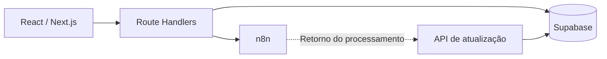

# ⚡ TaskFlow

Aplicação web de gerenciamento de tarefas com integração a fluxos de automação.


## Funcionalidades

- Cadastro, listagem e atualização de tarefas.
- Identificação por nome ou e-mail.
- Indicadores de tarefas totais e concluídas.
- Persistência no Supabase.
- Integração com webhook n8n para processamento de títulos.

## Arquitetura



## Executar localmente

```bash
git clone https://github.com/Dropisx/todo-list.git
cd todo-list
npm ci
npm run dev
```

Configure antes da execução as variáveis em `.env.local`:

```dotenv
SUPABASE_URL=
SUPABASE_SERVICE_ROLE_KEY=
```

Mantenha a chave de serviço exclusivamente no servidor. A tabela `todos` precisa conter os campos utilizados pela aplicação: `id`, `title`, `completed`, `user_identifier` e `created_at`.

Acesse http://localhost:3000.

## Status e limitações

Protótipo de desenvolvimento. A identificação por nome ou e-mail não constitui autenticação. Antes de uso em produção, implemente autenticação, autorização por usuário, proteção do callback de automação e configuração externa do webhook. A interface solicita exclusão de tarefas, mas a rota correspondente não está presente na estrutura atual. O fluxo n8n externo não está incluído neste repositório.

## Autor

[Dropisx](https://github.com/Dropisx)
