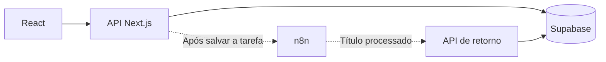

# TaskFlow

Protótipo full stack de gerenciamento de tarefas. Desenvolvi a interface em **React e TypeScript**, a API com **Next.js**, a persistência no **Supabase** e a integração com **n8n** para processar títulos em segundo plano.

[Pedro Henrique Valeriano no LinkedIn](https://www.linkedin.com/in/pedro-valeriano-2b3012313/) · [Portfólio Dropisx](https://github.com/Dropisx)

## O que implementei

- **Interface** para cadastrar tarefas, listar por identificador e alternar entre pendente e concluída. O painel calcula o total e o número de tarefas concluídas.
- **API** com rotas Next.js para criar, listar e atualizar tarefas. A listagem consulta o Supabase usando o identificador informado na interface.
- **Integração assíncrona** que tenta enviar o ID e o título ao n8n depois de salvar a tarefa. Um retorno do fluxo pode atualizar o título no banco.



## Como rodar localmente

Você precisa de **Node.js 20.9 ou superior**, **npm**, **Git** e um projeto Supabase de desenvolvimento.

### 1. Baixe o projeto

```bash
git clone https://github.com/Dropisx/todo-list.git
cd todo-list
npm ci
```

### 2. Crie a tabela no Supabase

No **SQL Editor** do seu projeto de desenvolvimento, execute:

```sql
create table public.todos (
  id uuid primary key default gen_random_uuid(),
  title text not null,
  completed boolean not null default false,
  user_identifier text not null,
  created_at timestamptz not null default now()
);

alter table public.todos enable row level security;
```

Crie um arquivo `.env.local` na raiz do projeto:

```dotenv
SUPABASE_URL=https://SEU-PROJETO.supabase.co
SUPABASE_SERVICE_ROLE_KEY=SUA_CHAVE_SERVICE_ROLE
```

Use a URL e a chave `service_role` do seu projeto. A chave fica somente no servidor e no arquivo local. Mantenha o `.env.local` fora do Git.

### 3. Rode e experimente

Para experimentar apenas o fluxo de tarefas, desative na sua cópia local a chamada ao webhook dentro do `POST` em [`src/app/api/todos/route.ts`](src/app/api/todos/route.ts). A URL está definida no código e o fluxo n8n não acompanha o repositório.

```bash
npm run dev
```

Abra [http://localhost:3000](http://localhost:3000), informe um identificador fictício como `demo-taskflow`, crie uma tarefa e marque-a como concluída. Recarregue a página e informe o mesmo identificador para conferir a persistência.

## Onde está cada parte

| Arquivo | Responsabilidade |
| --- | --- |
| [`src/app/page.tsx`](src/app/page.tsx) | Interface, estados e indicadores |
| [`src/app/api/todos/route.ts`](src/app/api/todos/route.ts) | Listagem, criação, atualização e envio para o n8n |
| [`src/app/api/todos/ai/route.ts`](src/app/api/todos/ai/route.ts) | Recebimento do título processado e atualização no Supabase |
| [`src/lib/supabase.ts`](src/lib/supabase.ts) | Cliente Supabase usado no servidor |

## Status do protótipo

O identificador informado na interface serve para filtrar a listagem. Para produção, ainda faltam autenticação, autorização por usuário, proteção da rota de retorno da automação e configuração externa do webhook. A interface também exibe uma opção de exclusão cuja rota ainda precisa ser implementada.
